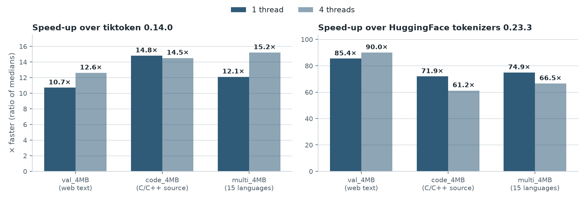
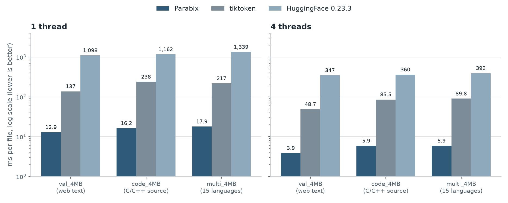
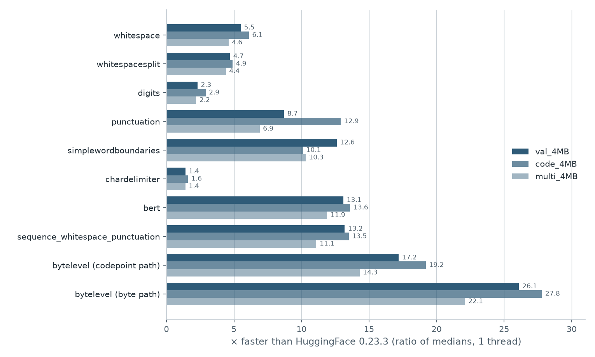

<div align="center">

# ⚡ Parabix Tokenizer: results

**A GPT-2 byte-level BPE tokenizer that processes text as bit streams.**<br>
Output identical to HuggingFace `tokenizers` and OpenAI `tiktoken`, 11–15× faster than tiktoken
and 61–90× faster than HuggingFace 0.23.3 on 4 MB inputs.

[](#-correctness)
[](../README.md#limitations)
[](#-results)
[](#-results)


[Results](#-results) · [Correctness](#-correctness) · [Reproduce](#-reproduce) · [Implementation](../README.md) · [Scripts](#test-and-benchmark-scripts)

</div>

---

## 🚀 Results

<p align="center">
  <picture>
    <source media="(prefers-color-scheme: dark)" srcset="assets/speedup-dark.png">
    
  </picture>
</p>

Time to tokenize a whole 4 MB file, cold caches: median of three rounds of five runs (minimum over all 15 runs in brackets). Speed-up: the reference's median over Parabix's.

| Threads | Input | **Parabix** | tiktoken 0.14.0 | HF `tokenizers` 0.23.3 | vs tiktoken | vs HF |
|:-:|---|--:|--:|--:|:-:|:-:|
| 1 | `val_4MB` (web text) | **12.9 ms** (12.7) | 137 ms (135) | 1,098 ms (1,080) | **10.7×** | **85.4×** |
| 1 | `code_4MB` (C/C++ source) | **16.2 ms** (15.7) | 238 ms (237) | 1,162 ms (1,146) | **14.8×** | **71.9×** |
| 1 | `multi_4MB` (15 languages) | **17.9 ms** (17.4) | 217 ms (214) | 1,339 ms (1,319) | **12.1×** | **74.9×** |
| 4 | `val_4MB` | **3.86 ms** (3.77) | 48.7 ms (48.3) | 347 ms (341) | **12.6×** | **90.0×** |
| 4 | `code_4MB` | **5.89 ms** (5.70) | 85.5 ms (84.7) | 360 ms (348) | **14.5×** | **61.2×** |
| 4 | `multi_4MB` | **5.89 ms** (5.68) | 89.8 ms (88.9) | 392 ms (381) | **15.2×** | **66.5×** |

<details>
<summary><b>Absolute times (log scale)</b></summary>

<p align="center">
  <picture>
    <source media="(prefers-color-scheme: dark)" srcset="assets/speed-time-dark.png">
    
  </picture>
</p>

</details>

> [!NOTE]
> **Measurement conditions.** Apple M3, macOS, measured on 2026-11-19 (commit `4225b1fab`, with `master` merged), with the recommended options
> (see [Reproduce](#-reproduce)). Parabix and HF caches are emptied before every run. Every engine uses
> the same number of threads: at 4 threads, HF and tiktoken run `encode_batch` over the text split at
> pre-token boundaries. The inputs are the original file bytes (`val_4MB` keeps its CRLF line ends and NUL runs).
> These are **tokenization times only**: a one-shot run of the command-line tool also loads the rules,
> builds the tables and the pipeline (about 60 ms) and formats the output. The numbers are from one
> machine; the Intel x86-64 run is not in this table. The previous run (2026-11-16, five rounds of ten
> runs) gave Parabix times within 5% of these.
> Per-script options: [Scripts](#test-and-benchmark-scripts).

### Pre-tokenizers on their own

Each pre-tokenizer timed alone against HuggingFace 0.23.3, 1 thread, whole 4 MB files, median of three rounds of five calls (2026-11-19, commit `4225b1fab`). Ratio: HF median over Parabix median. In every case the pre-token strings and their order match HuggingFace's.

<p align="center">
  <picture>
    <source media="(prefers-color-scheme: dark)" srcset="assets/pretokenizers-dark.png">
    
  </picture>
</p>

The byte path is the GPT-2 boundary builder that the BPE pipeline uses; the codepoint path (`--pretokenizer=bytelevel`) decodes to codepoints first. Gains range from 1.4× (`chardelimiter`) to 27.8× (byte path, `code_4MB`). The two sides do not do the same work (HF also records offsets; Parabix writes the strings to `/dev/null`), so the ratios compare two complete standalone pre-tokenizers, not boundary finding alone.

## ✅ Correctness

Speed is only reported where the output is the same. On the tested inputs, the outputs are identical:

| Check | Inputs | Result |
|---|---|---|
| BPE ids vs HF 0.23.3 and tiktoken 0.14.0, original file bytes | 3 corpora + 7 single-language files, 1 and 4 threads | ✅ all 20 runs identical |
| Same, small segments (128, 1,024, 4,096 bytes) | 3 corpora, 4 threads | ✅ all 9 runs identical |
| Same, 1,024-byte segments | 3 corpora, 8 threads | ✅ all 3 runs identical |
| Character offsets (`--offsets=char`) vs HF `Encoding.offsets` | all 10 inputs | ✅ identical |
| Byte offsets (`--offsets=byte`) | all 10 inputs | ✅ ids match; spans tile the input |
| Pre-tokenizers vs HF | GPT-2 on all 10 complete inputs; the 8 other timed modes on the 3 corpora (24 cases) | ✅ same strings and order |
| Normalizers vs HF, 13 modes and 6 compositions | first 200 lines of each 4 MB file | ✅ all 19 match |
| Normalizers vs HF, codepoint sweep: 292,531 assigned codepoints, each alone, twice, after `a`, before U+0301 and between two `a`s | 10 modes | 5 modes match on every codepoint; the 5 built on Unicode normalization differ on 6–194 characters (`nfc` 6, `nfd` 24, `stripaccents` 21, `nfkc` 176, `nfkd` 194), all added in Unicode 10.0 or later. In every differing case of `nfc`, `nfd`, `nfkc` and `nfkd`, Parabix gives the Unicode 16.0 result (Python's `unicodedata`) and HF does not |
| Pre-tokenizers vs HF, codepoint sweep: the same 292,531 codepoints in the same contexts and after a space | 9 modes, the BPE front end, 10 behavior cases | ✅ all 20 match on every codepoint |

This is testing, not proof: the tests cover these inputs, not every possible input. What each check covers: [Validation](../README.md#validation).

## 🔁 Reproduce

Inputs are committed in [`../tokenizer_files/`](../tokenizer_files/): three 4 MB files, `val_4MB.txt` (web text, CRLF line ends, some NUL runs; 1,334,004 GPT-2 tokens, or 1,302,487 after `compare_bpe.py` turns CRLF into LF), `code_4MB.txt` (C/C++ source, 1,729,186) and `multi_4MB.txt` (15 languages, 2,230,628).
Setup (Python venv with `tokenizers` 0.23.3 and `tiktoken` 0.14.0) and the full option list: [Requirements](#requirements).
`BEST` is the recommended option string from [../README.md](../README.md#quick-start).

```bash
cd tools/lex/tokenizer-test

# correctness
python compare_bpe.py --no-timing --input ../tokenizer_files/code_4MB.txt --parabix-args="$BEST --thread-num=4"

# speed, 1 thread, cold caches, 5 runs per engine (one round; the table above is three rounds)
python bench_bpe.py --input ../tokenizer_files/val_4MB.txt ../tokenizer_files/code_4MB.txt \
    ../tokenizer_files/multi_4MB.txt --iters 5 --no-adaptive-iters \
    --parabix-args="$BEST --thread-num=1 --bench-cold-cache"

# speed, 4 threads
python bench_bpe.py --input FILE --iters 5 --no-adaptive-iters --baseline-threads 4 \
    --parabix-args="$BEST --thread-num=4 --bench-cold-cache"

# normalizers and pre-tokenizers, codepoint sweeps
python compare_normalizers.py --sweep
python compare_pretokenizers.py --sweep

# pre-tokenizers alone
python bench_pretokenizers.py --input ../tokenizer_files/val_4MB.txt \
    ../tokenizer_files/code_4MB.txt ../tokenizer_files/multi_4MB.txt
```

Benchmark on an idle machine: other work changes the timings, most of all at 4 threads.

---

# Test and benchmark scripts

Test and benchmark scripts for the Parabix tokenizer (`tools/lex`). Most of them
compare Parabix with **HuggingFace `tokenizers`** and **OpenAI `tiktoken`**
running the same GPT-2 model: these two are the references for correctness and
speed. `bench_configs.py` compares Parabix option sets with each other, and
`selfmerge_test.py` checks Parabix against a small reference BPE of its own.

None of them run under `make check`. Run them from this directory with the repo's
venv.

| Script | Kind | What it covers |
|---|---|---|
| `compare_normalizers.py` | correctness | Normalizers, against HF `tokenizers.normalizers` |
| `compare_pretokenizers.py` | correctness | Pre-tokenizers and `--behavior`, against HF `tokenizers.pre_tokenizers` |
| `compare_bpe.py` | correctness + timing | BPE token ids against HF `tokenizers` 0.23 and tiktoken |
| `compare_bpe_hf1.py` | correctness + timing | The same against HF `tokenizers` 1.0.0rc4 |
| `bench_pretokenizers.py` | correctness + performance | Pre-tokenizers on their own (no BPE) against HF 0.23: whole-file pre-token lists, then time |
| `bench_bpe.py` | performance | Throughput (MB/s) against HF 0.23 and tiktoken |
| `bench_bpe_hf1.py` | performance | The same against HF 1.0.0rc4 |
| `bench_configs.py` | performance (Parabix only) | Several Parabix option sets timed against each other, with an output-identity check |
| `selfmerge_test.py` | correctness (no HF) | Runs of repeated tokens (X+X→XX merges), against a built-in reference BPE |
| `assets/make_figures.py` | charts | Draws the charts of [README.md](README.md) (PNG, light and dark) from the numbers of its tables; needs `matplotlib`. Not a test. |

Each script copies its report to `<script>_output.txt` in this directory. Those
files are not committed, and they hold whatever the last local run wrote: re-run
before quoting one.

---

## Requirements

- **Python 3.10+**.
- **A built tokenizer**, by default `<repo>/build19/bin/tokenizer`
  (`make -C build19 -j8 tokenizer`); every script takes `--tokenizer PATH`.
- **HuggingFace `tokenizers`** and **`tiktoken`** from PyPI. The results below use
  `tokenizers` 0.23.3 and `tiktoken` 0.14.0. `compare_bpe.py` and `bench_bpe.py`
  import both.
- **`tokenizers` 1.0.0rc4**, only for the `*_hf1.py` scripts, in a side folder of
  the same venv (it has the same package name as 0.23).
- **`datasets`**, only for `bench_bpe.py --openwebtext`.

### One-time setup

```bash
cd <repo>
python3 -m venv .venv
.venv/bin/pip install "tokenizers==0.23.3" "tiktoken==0.14.0"
.venv/bin/pip install datasets                      # optional: --openwebtext

# HF 1.0 for compare_bpe_hf1.py / bench_bpe_hf1.py
.venv/bin/pip install numpy huggingface-hub
.venv/bin/pip install --no-deps --target .venv/hf1-site "tokenizers==1.0.0rc4"
```

The `*_hf1.py` scripts put `<venv>/hf1-site` (or `$HF1_SITE`) first on
`sys.path` before importing `tokenizers`, and stop unless they get version 1.x
and `tiktoken` 0.14.0 (`--any-tiktoken` allows another). The other scripts in the
same venv still get 0.23.3.

### Paths

Each script finds the repo from its own location (three levels up), so it runs
from any directory. Defaults and overrides:

| Option | Default | Scripts |
|---|---|---|
| `--tokenizer PATH` | `<repo>/build19/bin/tokenizer` | all |
| `--merges PATH` | `<repo>/tools/lex/tokenizer_files/merges.txt` | `compare_bpe*`, `bench_bpe*`, `bench_configs`, `selfmerge_test` |
| `--vocab PATH` | `<repo>/tools/lex/tokenizer_files/vocab.json` | `compare_bpe*` |
| `--tokenizer-json PATH` | `<repo>/tools/lex/tokenizer_files/tokenizer.json` | `compare_bpe*`, `bench_bpe*` |
| `--input PATH` | none (required) | `compare_bpe*`; `bench_bpe*` take `--input FILE …`, `--sweep --sweep-source FILE` or `--openwebtext`; `bench_pretokenizers` takes `--input FILE …` |
| `--input PATH` | `<repo>/build19/test.txt` (not in the repo) | `compare_normalizers`, `compare_pretokenizers` |
| `--input PATH` | `tokenizer_files/val_2MB.txt` (no longer in the repo) | `bench_configs` |

So pass `--input` to every script except `selfmerge_test.py`, which writes its
own input.

---

## Inputs

The GPT-2 model files and three 4 MB test files are committed in
`tools/lex/tokenizer_files/` (see the parent [Data files](../README.md#data-files)):

| File | Contents | Tokens (GPT-2) |
|---|---|---|
| `val_4MB.txt` | Web text, CRLF line ends, some NUL runs | 1,302,487 |
| `code_4MB.txt` | C++ source | 1,729,186 |
| `multi_4MB.txt` | Many languages | 2,230,628 |

`merges.txt` is the Parabix input; `tokenizer.json` is what HuggingFace loads;
`tiktoken` uses its built-in `gpt2` encoding, which has the same vocabulary and
merges. So all three run the same model.

Two notes on line ends:

- `compare_bpe*.py` read the input in text mode, so `\r\n` becomes `\n`, and all
  engines tokenize that text. `bench_bpe*.py` keep `\r\n`, so every engine reads
  the file's own bytes.
- `compare_pretokenizers.py` and `compare_normalizers.py` also read in text mode:
  `\r\n` and a lone `\r` become `\n`, so no `\r` is ever compared.
  `compare_pretokenizers.py` then compares line by line; `compare_normalizers.py`
  normalizes the whole text. `bench_pretokenizers.py` reads the file's own bytes,
  CRLF included. Both `--sweep` runs write their generated text as bytes, so the
  `\r` cases reach both tools as `\r`.

---

## `compare_normalizers.py`

Compares the normalized text of each `--normalize=X` with the matching HF
normalizer, character by character. 19 modes: `nfd`, `nfc`, `nfkd`, `nfkc`,
`stripaccents` (HF: `NFD` + `StripAccents`), `stripleft`, `stripright`, `strip`,
`bytelevel`, `lowercase`, `nmt`, `bertchinesechars`, `bertcleantext`, and the
sequences `bertcleantext,stripaccents,lowercase`,
`bertcleantext,bertchinesechars,stripaccents,lowercase`, `bytelevel,lowercase`,
`lowercase,strip`, `bytelevel,strip`, `bytelevel,strip,lowercase`.

```bash
python compare_normalizers.py --input FILE                 # all modes
python compare_normalizers.py --input FILE lowercase nfd   # some modes
python compare_normalizers.py --input FILE --hf-only       # HF side only
python compare_normalizers.py --input FILE --parabix-only  # Parabix side only
python compare_normalizers.py --sweep                      # codepoint sweep, 10 modes
python compare_normalizers.py --sweep nfc nfkc             # sweep some modes
```

`--sweep` replaces `--input` with every assigned codepoint of Python's
`unicodedata` (292,531 in Unicode 16.0; not `Cn`, not `Cs`), each in five
contexts: alone, twice, after `a`, before U+0301 and between two `a`s. Each tool
normalizes the whole text once, and the outputs are compared context by context.
For each mode the script lists the differing codepoints with their Unicode age
(from [`lib/ucd/data/DerivedAge.cpp`](../../../lib/ucd/data/DerivedAge.cpp)) and
the contexts that differ; for `nfc`, `nfd`, `nfkc` and `nfkd` it also counts the
differing contexts where each side equals `unicodedata.normalize`. Default modes:
the 10 single modes other than `strip`, `stripleft` and `stripright`, which change
only the ends of the text. Output: `compare_normalizers_sweep_output.txt`, about
12 s.

---

## `compare_pretokenizers.py`

Compares each `--pretokenizer=X` with the matching HF pre-tokenizer, line by
line. By default the tokenizer writes a line feed between pre-tokens, so a line
feed inside a pre-token cannot be told from a boundary: with `punctuation`,
`a\nb` is one pre-token in both tools but prints as two lines. Running each line
on its own avoids that (`--sweep` instead compares whole texts, with
`--pretok-separator=0x10FFFF`). At most `--max-lines` lines (default 200; 0 =
all).

| Parabix mode | HF pre-tokenizer |
|---|---|
| `whitespacesplit` | `WhitespaceSplit()` |
| `whitespace` | `Whitespace()` |
| `bytelevel` | `ByteLevel(add_prefix_space=False)` |
| `bert` | `BertPreTokenizer()` |
| `punctuation` | `Punctuation()` |
| `digits` | `Digits(individual_digits=True)` |
| `chardelimiter` | `CharDelimiterSplit(",")` |
| `sequence_whitespace_punct` (`--pretokenizer=sequence_whitespace_punctuation`) | `Sequence([WhitespaceSplit(), Punctuation()])` |
| `simplewordboundaries` | `Split(Regex(r"\w+"), "isolated")` |

`--behaviors` instead checks all 5 `--behavior=` values (`removed`, `isolated`,
`mergedwithprevious`, `mergedwithnext`, `contiguous`) for `simplewordboundaries`
(against `Split(Regex(r"\w+"), behavior)`) and `punctuation` (against
`Punctuation(behavior)`): 10 cases. `--parabix-only` also runs the
Parabix-specific cases in `tokenizertest.xml`, which have no HF counterpart.

```bash
python compare_pretokenizers.py --input FILE                       # all modes
python compare_pretokenizers.py --input FILE whitespace bytelevel  # some modes
python compare_pretokenizers.py --input FILE --behaviors           # the 10 behavior cases
python compare_pretokenizers.py --input FILE --parabix-only        # + tokenizertest.xml
python compare_pretokenizers.py --input FILE --hf-only
python compare_pretokenizers.py --sweep                            # codepoint sweep, 20 cases
python compare_pretokenizers.py --sweep bytelevel bytelevel_frontend
```

`--sweep` replaces `--input` with every assigned codepoint of Python's
`unicodedata` (292,531 in Unicode 16.0), each in six contexts: alone, twice,
after `a`, before U+0301, between two `a`s and after a space. Each context sits
on its own line, with a separator line `,0!a` between contexts; every mode splits
inside it, so no pre-token covers two contexts. Both sides pre-tokenize the whole
text (Parabix with `--pretok-separator=0x10FFFF`, so a line feed inside a
pre-token stays visible), and every differing pre-token is charged to the context
it overlaps. 20 cases: the 9 modes, `bytelevel_frontend` (the BPE front end's
boundaries, as in `bench_pretokenizers.py`) and the 10 `--behaviors` cases.
Output: `compare_pretokenizers_sweep_output.txt`, about 4 minutes.

---

## `compare_bpe.py`

End-to-end check: GPT-2 BPE token ids from Parabix, HF and tiktoken. The whole
input is one test case: one `encode(text)` call for HF, one
`encode(text, allowed_special="all")` for tiktoken, one tokenizer run for Parabix:

```
tokenizer --pretokenizer=bytelevel --vocab=vocab.json --merges=merges.txt <PARABIX ARGS> <input>
```

`--parabix-args="…"` adds tokenizer options (use the `=` form). The script adds
`--pretokenizer=bytelevel` only when the arguments name no pre-tokenizer. It
prints `Extra tokenizer flags: …` when any are given; no such line means the
default options were tested.

**Pass the recommended options.** With none, the tokenizer runs the old
merge-kernel design: correct, but its first run compiles 1,123 kernels. With the
options from the parent README:

```bash
BEST="--pretokenizer=bytelevel --tail-from-bytes --tail-vocab-table --tail-cache-pool \
--tail-scan-kernel --tail-emit-from-segs --tail-long-cache --tail-batch-bpe --tail-hard-split \
--tail-simd-emit --skip-identity-normalize --pretok-compress-classes --pretok-class-code \
--fast-emit --memsource-in-place --pretok-byte-domain --pretok-utf8-classes \
--tail-unit-seed --pair-cuts=3 --len-scan=15"

python compare_bpe.py --no-timing --input ../tokenizer_files/code_4MB.txt \
    --parabix-args="$BEST --thread-num=4"
```

Output: `MATCH` or `MISMATCH` and the token count of each engine. A second
Parabix run with `--strings` gives the token strings, so a mismatch prints a
side-by-side table (Parabix, HF, tiktoken) and the first position where they
differ. `--verbose` always prints the table.

**Timing section** (on by default; `--no-timing` turns it off, `--runs N` sets
the count, default 5): Parabix with `--bench-loop=N` and the same arguments, HF
and tiktoken as warm in-process loops. It adds N tokenizations per engine; for
proper benchmarks use `bench_bpe.py`.

```bash
python compare_bpe.py --input FILE --parabix-args="$BEST"   # check + timing
python compare_bpe.py --input FILE --no-timing ...          # check only
python compare_bpe.py --input FILE --no-tiktoken ...        # Parabix vs HF only
python compare_bpe.py --input FILE --parabix-only | --hf-only | --tiktoken-only
python compare_bpe.py --input FILE --show-input             # print the input text
```

The docstring at the top of `compare_bpe.py` still describes an older two-step
run and line-by-line cases; the code does what is described here.

## `compare_bpe_hf1.py`

`compare_bpe.py` with HF `tokenizers` 1.0.0rc4 (its "bitcannon" bit-stream
pre-tokenizer, word cache and whole-word fold) and tiktoken pinned to 0.14.0. HF
1.0's `Tokenizer.from_file()` only loads; `compile()` builds the
`CompiledTokenizer` that encodes (setup, not timed). Its results have ids only, so
token strings come from `id_to_token()`. `--cold` empties the caches before every
timed run (a fresh `compile()` for HF); `--bench-cold-cache` in `--parabix-args`
has the same effect.

```bash
.venv/bin/python compare_bpe_hf1.py --no-timing --input FILE --parabix-args="$BEST"
```

---

## `bench_bpe.py`

Throughput of Parabix, HF and tiktoken, in the style of HF's own criterion
benchmarks: a fixed input, N warm runs, MB/s. Each engine is timed in process,
without start-up:

- **Parabix**: `--bench-loop=N` builds and compiles the pipeline once, runs it N
  times on the in-memory input with output off (after one warm-up run), and
  prints `BENCH_RESULT bytes=… iters=… min_ms=… median_ms=… mean_ms=… mbps=…`.
  The script parses that line. `--pretokenizer=bytelevel` is added unless
  `--parabix-args` names a pre-tokenizer.
- **HF**: `encode()` of the whole text, model loaded by `Tokenizer.from_file()`.
- **tiktoken**: `encode(text, allowed_special="all")` (`--tiktoken-ordinary`:
  `encode_ordinary`).

It prints min, median and mean ms and peak MB/s (from the min) for each engine and
input, and a speed-up line computed from the min.

**Threads.** `--baseline-threads N` splits the text at safe pre-token boundaries
and times `encode_batch` on N threads for HF (`RAYON_NUM_THREADS=N`) and tiktoken.
Give Parabix the same number with `--thread-num=N` for an equal-threads
comparison.

**Caches.** Parabix keeps its caches across `--bench-loop` runs unless
`--bench-cold-cache` is given. `--hf-cache=match` (default) clears HF's word
cache before every run exactly when Parabix runs cold; `warm` and `cold` force it.

**Iterations.** Above 1 MB the count is scaled down (to at least 3) to hold the
time per input; `--no-adaptive-iters` uses `--iters` for every input, which gives
every engine the same number of runs. `--parabix-iters N` sets Parabix's count alone.

**Size sweep.** `--sweep --sweep-source FILE` cuts prefixes from 4 KB to 20 MB
(`--sweep-sizes 1,4,8` in MB, `--sweep-max-mb`) and fits
`min_ms = floor + slope · bytes` per engine: the floor is a fixed cost per call,
`1e-3 / slope` the marginal MB/s. This mattered for the merge-kernel design, whose
floor was large; the current design has a small one. The fit needs inputs of
different sizes, so ignore it when the inputs are all the same size.

```bash
python bench_bpe.py --input ../tokenizer_files/val_4MB.txt ../tokenizer_files/code_4MB.txt \
    ../tokenizer_files/multi_4MB.txt --iters 5 --no-adaptive-iters \
    --parabix-args="$BEST --thread-num=1 --bench-cold-cache"
python bench_bpe.py --input FILE --baseline-threads 4 --parabix-args="$BEST --thread-num=4"
python bench_bpe.py --sweep --sweep-source FILE --parabix-args="$BEST"
python bench_bpe.py --openwebtext                   # stream and cache an OpenWebText sample
python bench_bpe.py --input FILE --svg bench.svg    # also an MB/s bar chart
python bench_bpe.py --input FILE --parabix-only | --hf-only | --tiktoken-only | --no-tiktoken
```

## `bench_bpe_hf1.py`

`bench_bpe.py` with HF 1.0.0rc4 and tiktoken 0.14.0. Differences:

- HF 1.0 is cold when Parabix is (`--hf-cache=match`): a fresh `compile()`, not
  timed, before every run.
- HF 1.0's `encode_batch` uses its own pool of one thread per core and ignores
  `RAYON_NUM_THREADS`. So with `--baseline-threads N` the script runs N Python
  threads, each calling `encode()` on pieces of the text (`encode()` releases the
  GIL), and checks the process CPU time against N. `--hf-native-batch` times HF's
  own `encode_batch` instead (all cores: not an equal-threads comparison).

---

## `bench_pretokenizers.py`

Each pre-tokenizer on its own (no normalizer, no BPE), Parabix against HF, one
thread on both sides. The 9 modes of `compare_pretokenizers.py`, plus
`bytelevel_frontend`: `--pretokenizer=bytelevel` with the BPE front end's
boundary builder (`--pretok-compress-classes --pretok-class-code
--pretok-byte-domain --pretok-utf8-classes`), as the recommended BPE options run it.

1. **Check.** One tokenizer run with `--pretok-separator=0x10FFFF` on the whole
   file, compared with HF's `pre_tokenize_str`: the complete pre-token list,
   strings and order (not offsets). U+10FFFF must not be in the input, so, unlike
   `\n`, it cannot be mistaken for a line break inside a pre-token. A case that
   does not match is reported and not timed.
2. **Time.** `--rounds` rounds (default 3) of `--iters` timed calls (default 5)
   per side, the side that goes first alternating by round:
   - **Parabix**: `--bench-loop=N --thread-num=1 --segment-size=16384`. Built,
     compiled and loaded once; one untimed run, then N timed runs, each writing
     its pre-tokens to `/dev/null`. The script reads `BENCH_SAMPLES_MS`.
   - **HF**: per call, a fresh `PreTokenizedString(text)` and an in-place
     `pre_tokenize` (strings and offsets stay native, no Python lists). One
     untimed call, then N timed.

It reports the median of the round medians, their range, and HF median / Parabix
median. The two sides are complete pipelines with different outputs (serialized
text vs native strings with offsets), not boundary finding alone. Each case runs
in a fresh process, so HF allocations do not pile up from case to case.

```bash
python bench_pretokenizers.py --input ../tokenizer_files/val_4MB.txt \
    ../tokenizer_files/code_4MB.txt ../tokenizer_files/multi_4MB.txt
python bench_pretokenizers.py --input FILE --modes whitespace bytelevel_frontend
python bench_pretokenizers.py --input FILE --rounds 1 --iters 1     # quick check
python bench_pretokenizers.py --input FILE --json results.json      # every sample too
```

---

## `bench_configs.py`

Parabix option sets timed against each other; no HF. One run times N sets:

- **Interleaved rounds**: each round runs every set once, and each set keeps its
  best time over the rounds (`--rounds`, default 3; `--iters`, the `--bench-loop`
  count, default 5), so machine drift hits all sets alike.
- **Output identity** (`--verify`): each set runs once more without
  `--bench-loop`, and its ids are hashed against the first set's: `IDENTICAL` or
  `DIFFERS`. A faster set with different output is a bug, not a win.
- **Sizes** (`--sizes 0.25,1,4`, in MB): the floor/marginal fit per set, as in
  `bench_bpe.py --sweep`.

`--common-flags` (default `--pretokenizer=bytelevel`) is put before every set, so
**leave `--pretokenizer` out of the sets** (the tokenizer rejects it twice). The
first `--config NAME=FLAGS` is the baseline of the `vs base` column. The `kernels`
column counts merge kernels and shows `-` for the current design. Example, the
per-length kernels against a single scan kernel:

```bash
B="--tail-from-bytes --tail-vocab-table --tail-cache-pool --tail-scan-kernel \
--tail-emit-from-segs --tail-long-cache --tail-batch-bpe --tail-hard-split --tail-simd-emit \
--skip-identity-normalize --pretok-compress-classes --pretok-class-code --fast-emit \
--memsource-in-place --pretok-byte-domain --pretok-utf8-classes --tail-unit-seed"

python bench_configs.py --input ../tokenizer_files/code_4MB.txt --verify \
    --config "best=$B --pair-cuts=3 --len-scan=15" \
    --config "single-scan=$B"
```

Add `--bench-cold-cache` to time cold caches. Without `--config`, the default
sets are the merge-kernel design with and without `--partition=level`.

---

## `selfmerge_test.py`

Self-merges (X+X→XX) need care in the merge-kernel design: a run of equal tokens
must pair left to right, each token used once (`XXXXX` → `XX XX X`). The script
writes its own input (runs of 1 to 12 copies of single bytes, multi-byte
characters and short strings, in several contexts, plus mixed patterns), and
compares the tokenizer's ids with a reference BPE in Python built from
`merges.txt` (lowest rank first, leftmost on a tie). It needs neither HF nor
`vocab.json`.

The tokenizer runs **without a pre-tokenizer** (the whole input is one sequence,
`\n` is content), so the test applies to the merge-kernel design; the current
design needs a pre-tokenizer.

```bash
python selfmerge_test.py                                   # 8 built-in merge-kernel option sets
python selfmerge_test.py --config 'mine=--partition=level --compact-base=2' --keep /tmp/sm
```

`--keep DIR` saves the input, the reference ids and each output. It prints
`MATCH` or `MISMATCH` per set and exits 1 on any mismatch. A new set's first run
compiles its kernels, which takes minutes.

---

## Tokenizer options

The tokenizer's options are documented once, in the parent
[README](../README.md): [Tokenizer options](../README.md#tokenizer-options),
[Options of the current design](../README.md#options-of-the-current-design) and
[merge-kernel options](../README.md#merge-kernel-options).

---

## Gotchas

- **Pass `--input`.** Only `selfmerge_test.py` has an input of its own.
- **Pass the recommended options to `compare_bpe*.py` and `bench_bpe*.py`.**
  Without them they test the slow merge-kernel design.
- **No need to clear `~/.parabix/objcache`** after a rebuild or between option
  sets: cached kernels belong to the build that made them, and kernel names
  encode their options. Use `-object-cache-dir=DIR` for a private cache.
- **Benchmark on an idle machine.** Other work on the machine (a build, another
  test, file writes) changes the timings, most of all at 4 threads.
- **Compare equal threads and equal caches**: `--thread-num=N` with
  `--baseline-threads N`, and `--bench-cold-cache` with `--hf-cache=match`.
- **`dyld: Library not loaded: @rpath/libparabix_*.dylib`** means the framework
  libraries are stale: run `make -C build19 -j8 tokenizer`.
